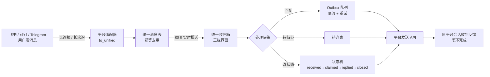
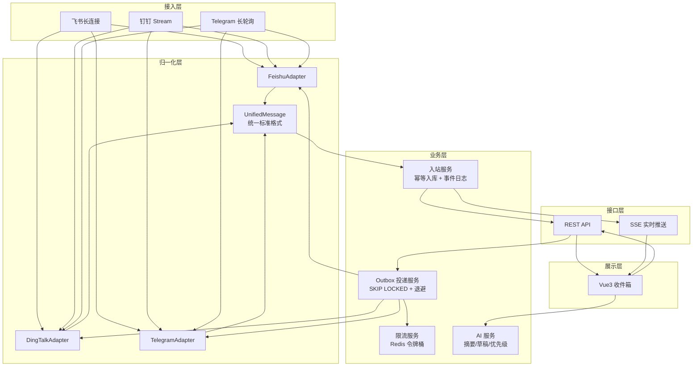

# 统一消息收件箱 · 多平台连接器
## 赛题 A 设计文档（初赛精简版）

> 一句话：把飞书、钉钉、Telegram 三个平台的消息收进一个网页收件箱，
> 在同一个界面里完成「看到 → 处理 → 回复 → 状态回流」的完整业务闭环。

---

## 1. 问题与用户

**目标用户**：同时被多个办公/社交平台割裂的小团队、外包工作室、学生竞赛团队。
他们每天要在 3 个 App 之间来回切换，漏消息、漏待办、回复不及时。

**核心痛点**：
1. 消息分散在多个平台，没有统一入口；
2. 看到了不等于处理了，缺少状态跟踪（谁在处理、处理到哪一步）；
3. 回复要在原平台进行，跨平台协作要手工复制粘贴。

**我们的闭环**：在统一入口里对外部消息做处理决策，并把决策**结果回流到原平台**，
让对方（不在我们系统里的人）也能感知到「已被受理 / 已在处理 / 已关闭」。

**回执是可选的**：改状态首先是处理人自己的进度记录，默认只在内部生效；
需要让对方知道进度时，勾选「改状态时给对方发一条回执」才会真正发出。
这样既保住状态流转能力，又不会用「[统一收件箱] 已标记为…」这类系统消息把真实对话刷满——
后者在实测里会把用户说的话顶出视野，属于用功能换体验的负优化。

---

## 2. 业务闭环设计

### 2.1 主流程

关键点：**箭头必须回到原平台**。只做「接收 + 展示」是单向的，不构成闭环；
本设计里 `回复` 一定出站，`改状态 / 转待办` 在勾选「发回执」时出站。

### 2.2 消息状态机

| 状态 | 进入条件 | 出站回执（默认关，可勾选） |
| --- | --- | --- |
| `received` | 入站消息落库 | — |
| `claimed` | 在收件箱点「转待办」或「标记处理中」 | 勾选后向原会话发「已在处理」 |
| `replied` | 从统一入口发送回复成功入队 | 回复正文本身（必发） |
| `closed` | 点「关闭」 | 勾选后向原会话发「已关闭」 |

每次状态变更同时写一条 `feedback` 记录（old_value → new_value），
用于赛后统计与「数据反馈」评分点的举证。

### 2.3 端到端用户旅程（演示脚本）

1. 同事在**飞书**给机器人发「报价单帮我看下，今天要」；
2. 收件箱 1 秒内出现该会话与未读角标（SSE 推送，无需刷新）；
3. 点「AI 摘要」→ 模型给出 120 字摘要并自动判定优先级 `urgent`（命中"今天/急"等词）；
4. 点「AI 草稿」→ 生成回复草稿，人工改两个字；
5. 点「发送回复」→ 队列投递 → 飞书里同事收到回复（这一步必发，是真正的回复）；
6. 点「转待办」→ 生成待办事项，消息状态变 `claimed`（内部记录，不打扰对方）；
7. 勾选「改状态时给对方发一条回执」后再点「关闭」→ 飞书侧才收到「已关闭」提示；
8. 同一套操作换**邮箱**、**Telegram** 各走一遍，界面完全一致。

---

## 3. 系统架构

**分层与接口规范**：
- 适配器层只做「平台格式 ⇄ 统一格式」转换，不含业务逻辑，新增平台 = 新增一个文件；
- 业务层不感知具体平台，只处理 `platform` 字符串 + 统一字段；
- 出站一律走 Outbox，接口层不直接调用平台 API，保证「接口失败不阻塞 UI」。

**独立部署**：`docker-compose.yml` 四个服务（postgres / redis / api / web），
`docker compose up -d --build` 一条命令启动，无任何外部依赖（AI 不配 key 自动降级）。

---

## 4. 核心接口

| 方法 | 路径 | 作用 |
| --- | --- | --- |
| GET | `/api/v1/platforms` | 各平台连接状态、限流余量 |
| POST | `/api/v1/platforms/{p}/test` | 连通性自检（初赛验证证据） |
| GET | `/api/v1/inbox/threads` | 按「平台+会话」聚合的收件箱列表 |
| GET | `/api/v1/inbox` | 消息列表（平台/状态/会话/关键词过滤） |
| GET | `/api/v1/inbox/{id}` | 单条消息详情 |
| POST | `/api/v1/inbox/{id}/reply` | **发送反馈**：回复并回流原平台 |
| POST | `/api/v1/inbox/{id}/todo` | **处理**：转待办 |
| PATCH | `/api/v1/inbox/{id}/status` | 改处理状态（`notify=true` 时把回执发回原会话） |
| PATCH | `/api/v1/inbox/{id}/priority` | 人工调整紧急程度（AI 判错可改回） |
| POST | `/api/v1/inbox/read` | 标记已读 |
| POST/PATCH | `/api/v1/inbox/bulk/{read,status,priority}` | 批量标记已读 / 改状态 / 改紧急度（只作用于入站消息） |
| POST | `/api/v1/inbox/{id}/summarize` | AI 摘要 + 优先级判定 |
| POST | `/api/v1/inbox/{id}/draft` | AI 回复草稿 |
| POST | `/api/v1/inbox/{id}/forward` | 跨平台转发（A 平台消息 → B 平台会话） |
| GET | `/api/v1/todos` / `PATCH /api/v1/todos/{id}` | 待办列表与状态更新（`notify=true` 时回执原会话） |
| GET | `/api/v1/inbox/{id}/attachments/{i}` | 附件代理下载 / 内联预览（凭证不出服务器） |
| GET/POST/DELETE | `/api/v1/platforms/{saved,connect}` | 运行时接入平台：填凭证即生效，不用改 .env、不用重启 |
| GET | `/api/v1/auth/feishu/url` · `/auth/accounts` | 用户身份 OAuth（目录能力；消息历史受平台权限限制） |
| GET | `/api/v1/events` | SSE 实时推送 |
| GET | `/api/v1/stats/overview` | 看板：各平台处理量、平均处理时长、队列健康度 |

---

## 5. 关键表结构

**message（统一消息表）**

| 字段 | 类型 | 说明 |
| --- | --- | --- |
| id | bigserial | 主键 |
| platform | varchar(32) | feishu / dingtalk / telegram |
| platform_msg_id | varchar(128) | 平台内消息 ID，与 platform 组成唯一键（幂等去重） |
| chat_id | varchar(128) | 会话 ID |
| chat_type / chat_title | varchar | 单聊/群聊、群名 |
| sender_id / sender_name | varchar | 发送者 |
| msg_type | varchar(16) | text / file / image |
| text_body | text | 统一后的正文 |
| attachments | jsonb | 统一附件数组 |
| direction | varchar(4) | in / out |
| status | varchar(16) | received / claimed / replied / closed |
| priority | varchar(8) | urgent / normal / low |
| created_at | timestamptz | 消息时间 |
| raw | jsonb | 平台原始 payload（排障） |

唯一约束 `uq_message_platform_msgid (platform, platform_msg_id)` —— 平台重投不产生重复。

**outbox（出站可靠投递表）**

| 字段 | 说明 |
| --- | --- |
| payload jsonb | `{kind: text|file|status, text/path/status}` |
| status | queued → sending → sent / failed → dead |
| attempts | 已尝试次数 |
| next_retry_at | 下次重试时间（指数退避 `min(2^n,60)` + 抖动） |
| last_error | 最后一次失败原因 |

worker 用 `FOR UPDATE SKIP LOCKED` 抢任务，多副本部署不会重复消费。

**todo / feedback / event_log**：待办事务、状态变更流水、原始事件留痕（见 `backend/sql/001_init.sql`）。

---

## 6. 平台对接方案

| 平台 | 入站 | 出站 | 免公网 | 备注 |
| --- | --- | --- | --- | --- |
| 飞书 | `lark-oapi` WebSocket 长连接，订阅 `im.message.receive_v1` | `im/v1/messages`，文件先 `im/v1/files` 换 file_key | ✅ | 主平台，免费版可建企业自建应用 |
| 钉钉 | `dingtalk-stream` Stream 模式，`ChatbotHandler` | 优先 `sessionWebhook`，兜底 `robot/groupMessages/send` | ✅ | 需在应用内开启机器人并选 Stream |
| Telegram | `getUpdates` 长轮询 | `sendMessage` / `sendDocument` | ✅ | @BotFather 生成 token 即用 |

**三个平台全部是出站长连接**，因此不需要公网 IP、不需要备案域名、不需要内网穿透 ——
这是本题最容易踩的坑，也是我们架构上的第一优先级决策。

---

## 7. AI 能力与降级（创新点）

| 能力 | 正常路径 | 降级路径（无 API Key / 调用失败） |
| --- | --- | --- |
| 消息摘要 | 大模型 120 字摘要 | 首句截断 + 关键词抽取 |
| 优先级判定 | 模型返回 urgent/normal/low | 规则命中表（急/尽快/今天/截止/asap/投诉/故障…） |
| 回复草稿 | 结合上下文生成 | 模板：确认收到 + 承诺时间 + 署名 |

**降级不是兜底摆设**：演示时故意断开 LLM 网络，界面照常可用，只是把「AI 摘要」标成「规则降级」——
这直接对应评分项里的「意图失败/边界处理」。

---

## 8. 异常与边界处理

| 场景 | 处理方式 | 可观测性 |
| --- | --- | --- |
| 平台限流 | Redis 令牌桶预判，拿不到令牌不阻塞，消息回队列延后 | `/platforms` 显示余量 |
| 发送失败 | 指数退避重试 5 次，超过进死信 | 看板「出站队列」计数 |
| 平台重复投递 | `(platform, platform_msg_id)` 唯一键 | `event_log` 留原始事件 |
| 机器人自发消息 | 钉钉按 `senderStaffId == chatbotUserId` 过滤 | 日志 debug |
| 某平台未配置 | 启动时跳过并记 warning，不拖垮其他平台 | `/healthz` 明确标出未就绪 |
| 数据库/Redis 未就绪 | Redis 不可用时限流降级放行；DB 不可用时启动失败快速退出 | 容器 restart 策略 |
| 大文本/文件 | 正文截断入库 + 附件走平台 file_key，不落盘 | `attachments` 字段 |

---

## 9. 初赛验证证据（可复现）

1. **三个平台连通**：`POST /api/v1/platforms/{p}/test` 返回 `ok: true` + 实际消息 ID，附三个平台截图；
2. **归一化一致性**：`pytest backend/tests/test_convert.py` 全绿，含「三平台字段集合完全一致」断言；
3. **端到端闭环**：录屏 8 步用户旅程（飞书发→收件箱→回复→回到飞书）；
4. **限流与重试**：把钉钉 rpm 临时调成 1，连发 5 条，看板可见 `queued` 堆积后逐步 `sent`；
5. **降级**：清空 `LLM_API_KEY` 重启，摘要/草稿仍可用并标注「规则降级」。

---

## 10. 决赛计划（12/20）

- [ ] 会话级上下文聚合：同一会话多轮消息合并成一条「工单」，支持批量处理；
- [ ] 规则引擎：关键词/正则/发送人 → 自动打标签、自动分派、自动回复；
- [ ] 权限与多租户：管理员/坐席角色，会话分配；
- [ ] 可观测性：Prometheus metrics + 简单 Grafana 面板；
- [ ] 演示视频 5–8 分钟：三平台闭环 + 故障注入（断网/限流/密钥失效）。
